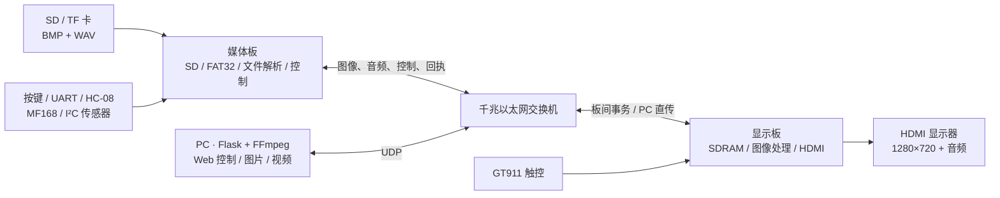

# 双板多媒体展示系统


**本地电子相册 · 多窗口展示 · 实时图像处理 · 网络音视频播放**

本项目围绕 2026 年嵌入式相关竞赛选题一开发，采用两块同型号开发板，分别承担媒体读取与显示处理。读卡、文件解析、缓存、图像处理及本地音视频播放均由 RTL 硬件逻辑完成，无需额外 CPU 或软核处理器；PC 提供可选的 Web 控制、图片上传和视频解码发送功能。

[功能特性](#功能特性) · [系统架构](#系统架构) · [快速开始](#快速开始) · [资源与验证](#资源与验证) · [文档导航](#文档导航)

## 功能特性

### 本地播放

| 功能 | 当前实现 |
| --- | --- |
| SD / TF 卡读取 | 原生 SD 协议、3.3 V、4-bit、最高 50 MHz High Speed，只读；卡不支持高速模式时保留 25 MHz 路径 |
| FAT32 文件系统 | 根目录扫描、MBR 分区与无分区 FAT32、簇链读取；最多 **32 个 BMP/WAV 文件条目，二者共用容量** |
| 图片解析 | 24-bit 非压缩 BMP，尺寸范围 **1–1280 × 1–720**；转为 RGB565 传输与存储 |
| HDMI 显示 | 固定 **1280×720** 输出；单图居中、填充黑边，保留源图宽高供 OSD 显示 |
| 图音配对 | 同名 BMP/WAV 配对，单图切换时提交图像与对应音轨；无配对 WAV 时静音，已装载音轨循环播放 |
| 音频输出 | 素材为 **24 kHz、unsigned 8-bit、单声道 PCM WAV**；显示端重复采样并转换为 HDMI **48 kHz** 左右声道输出 |
| 播放操作 | 上一张、下一张、自动轮播，周期 **1–10 秒**；三个实体按键提供下一张、轮播开关、上一张 |

### 图像与显示扩展

| 功能 | 当前实现 |
| --- | --- |
| 三种布局 | **单图、左右双图、四宫格**；多窗口等比例最近邻缩小、居中补黑，不放大小图片 |
| 独立窗口切图 | 请求发生时锁定光标所在窗口，保留其他窗口内容；允许不同窗口显示同一图片 |
| 三种转场 | **直接切、淡入淡出、滑动转场**，单图与多窗口均支持 |
| 六种图像模式 | **原图、灰度、二值化、Sobel 梯度、锐化、雪花**，作用于最终全屏图片画面 |
| 实时调节 | 音量 0–8、亮度 0–8、对比度 0–6 |
| 参数 OSD | 显示源图分辨率与播放参数；支持关闭、调节后显示 3 秒、始终显示 |
| 滚动字幕 | 最多 **160 个可打印 ASCII 字符**，支持上传与清空；透明背景、16×32 彩色字形 |
| HDMI 音频频谱 | 自研 **512 点 DFT 的 16 个选定频点**，输出 16 路频谱柱，支持开关与灵敏度调节 |

### 控制与网络媒体

| 功能 | 当前实现 |
| --- | --- |
| 多种控制入口 | 以太网、USB UART、HC-08 蓝牙串口、实体按键；串口/蓝牙使用 `[CMD, ~CMD]` 命令帧，并支持字幕与状态回包 |
| GT911 触控 | 单指相对移动、角色光标、左右横划切图；光标位置决定多窗口操作目标 |
| MF168 激光手势 | 两路测距模块支持左右滑动切图、双束距离变化调节亮度，以及板载 LED 指示 |
| 媒体传输 | 标准 MTU 下的 UDP 分包；图像累计校验与重试，视频按行 CRC 校验与接收端流控；未使用巨型帧 |
| PC 图片上传 | 浏览器解码常见图片，后端转换为正式 RGB565 帧；单图可附加音轨，多窗口替换光标所在窗并保留布局 |
| PC 视频播放 | 本机 FFmpeg 将 MP4 等视频转换为 **640×360 RGB565、约 60 fps** 与 PCM 音频；显示端按横纵各 2 倍最近邻放大至全屏 |
| Web 控制台 | Flask 后端、桌面/窄屏布局、ACK 与状态显示、字幕、图片上传、视频启停、D 源图预览及 BMP 像素对比 |

相对于基础的读卡、缓存、图片轮播和 HDMI 音频链路，当前已实现图层/字幕、转场、缩放适配、参数/OSD 和音频可视化五类展示扩展。

### 外设接入进度

| 外设 | 当前发布版状态 |
| --- | --- |
| BMP280 + AHT10 | 已实现媒体板 I²C 初始化、周期原始采样和以太网查询，返回校准字节与样本；物理量换算和 HDMI 温湿度/气压面板尚未接入 |
| IS31FL3731 LED 点阵 | 已实现 I²C 驱动、固定测试阶梯与亮灭联动；当前 `PRODUCT_LED_TEST_PATTERN=1`，尚未使用真实 DFT 频谱，转场存在偶发漏触发 |

## 系统架构



- **媒体板**：读卡、解析 BMP/WAV、维护播放列表和控制状态，通过有界缓冲发送源图像素与音频，不使用媒体板 SDRAM 缓存整帧。
- **显示板**：接收源尺寸图像，在 SDRAM 中准备画面，执行补黑、缩小、多窗口和转场，再进行 CV 处理与频谱、字幕、OSD、光标叠加。
- **PC**：普通控制发往媒体板，图片与视频负载直接发往显示板。视频采用 BRAM 前端缓存与 SDRAM 行队列结合的流式路径，并按接收端反馈推进发送。
- **事务仲裁**：图像/布局以板卡最终提交结果为准；控制台根据真实忙状态锁定冲突操作，提供状态查询恢复入口。

### 运行约定

- **布局切换**：单图可以切到双图或四宫格；双图与四宫格之间需先返回单图。
- **多窗口音频**：延续进入多窗口前的单图音轨，布局切换与窗口切图不替换它；返回单图时装载所选图片的配对 WAV。当前不支持随光标切换音轨。
- **视频独占显示**：播放期间仅音量、状态和停止操作可用；图片 CV 与 HDMI 频谱暂时旁路，停止或自然结束后恢复原图片布局及控制。当前不支持窗口内视频或从 SD 卡播放视频。
- **PC 上传**：图片属于临时展示内容，后续 SD 切图从该窗口原索引继续；附加音轨仅限单图模式，PC 端限制为前 60 秒。
- **D 快照**：媒体板从 SD 重读当前已提交/焦点源图，不包含显示端的黑边、缩放、CV、字幕或光标，也不是 HDMI/显存读回。
- **触控范围**：GT911 已用于光标与切图，尚未提供音量、轮播及全部 OSD 菜单的触控操作。

## 快速开始

### 1. 连接硬件

基础配置：两块同型号开发板、SD/TF 卡、千兆交换机及网线，以及支持 HDMI 音视频的显示设备。PC 接入同一交换机，用于控制和网络媒体上传。

| 设备 | 固定网络地址 | JTAG | 工程入口 |
| --- | --- | --- | --- |
| 显示板 | `192.168.137.2` | `cable0` | [lab_ex5_i2s_v1.0.al](board_display/td_project/lab_ex5_i2s_v1.0.al) |
| 媒体板 | `192.168.137.3` | `cable1` | [media_net.al](board_media/td_project/media_net.al) |
| PC | `192.168.137.1/24` | — | [Web App](scripts/web_console/app.py) |

普通控制使用板卡 UDP `:1`，PC 控制回包使用 UDP `:2`；图片和视频使用各自的发送/反馈通道。精简网络栈的在线检查使用 App 状态/布局回执，不以 ICMP Ping 为依据。首次连接时允许 Python 通过专用网卡收发 UDP。

可选外设按所在板卡接线，电源及接线细节见对应专题文档：

| 板卡 | 外设 | 信号引脚 |
| --- | --- | --- |
| 显示板 | GT911 | SCL=`M15`，SDA=`L16` |
| 显示板 | IS31FL3731 | SCL=`J12`，SDA=`K11` |
| 媒体板 | HC-08，9600 baud / 8N1 | 板端 RX=`M15`，TX=`L16` |
| 媒体板 | BMP280 + AHT10 | SCL=`K12`，SDA=`L14` |
| 媒体板 | 两路 MF168，115200 baud / 8N1 | 左路 RX=`J4`，右路 RX=`H4` |

### 2. 准备 SD 卡素材

将卡格式化为 FAT32，图片与配对音频放在根目录，使用 **8.3 短文件名**。同名文件构成一组：

```text
SD 卡根目录/
├── IMG0.BMP     # 24-bit 非压缩 BMP，最大 1280×720
├── IMG0.WAV     # PCM，24 kHz / 8-bit unsigned / mono
├── IMG1.BMP     # 无配对 WAV：单图播放时静音
└── ...         # BMP 与 WAV 合计最多 32 个条目
```

素材转换和测试镜像生成工具见 [prep_media.sh](scripts/prep_media.sh)、[gen_card.sh](scripts/gen_card.sh)。上电前插卡，复位后重新初始化；当前实现以固定插卡使用为前提。

### 3. 获取并烧录配套固件

正式固件归档于 **`dual-V4.0`**；`final` 指向后续仓库整理提交。主线保留源码、工程与文档，生成的 bit、综合/时序报告和构建清单保存在发布标签中。可在仓库根目录用 PowerShell 提取完整发布快照：

```powershell
git archive --format=zip --output=dual-V4.0.zip dual-V4.0
Expand-Archive -Path ./dual-V4.0.zip -DestinationPath ./release-v4

# 按顺序下载两份 V4 bit 到易失 SRAM
./release-v4/scripts/program_sram.ps1 -Board display
./release-v4/scripts/program_sram.ps1 -Board media
```

两板应使用同一发布版配套固件。上述下载掉电丢失；需上电自启动时，另在开发工具的下载界面将对应固件写入两板 Flash。CLI 路径、综合/布局布线命令、下载权限和 USB 故障判断见 [构建与下载指南](docs/td_cli_programming.md)。

### 4. 启动 Web 控制台

```powershell
python -m pip install flask pyserial
python scripts/web_console/app.py
```

浏览器访问 **<http://127.0.0.1:5000>**：

- **以太网页**：控制播放、布局、CV、字幕与参数；上传图片/配对音频，或选择视频并开始/停止播放。
- **串口页**：连接 USB UART，默认 **1 Mbps、8N1**；蓝牙模块使用独立 **9600 baud** 入口，命令字节相同。
- **视频/音轨转换**：使用本机 FFmpeg，可通过 `FFMPEG` 环境变量指定；仅视频发送也可用 `VIDEO_FFMPEG` 指定。板卡接收 RGB565/PCM，不直接解码 MP4、H.264 或 AAC。

连接状态、忙状态、ACK 与最终提交状态会显示在页面上。按钮下的命令字符用于协议说明，页面不监听全局键盘快捷命令。完整操作与 API 见 [Web 控制台](docs/web_console.md)，手机蓝牙十六进制发送示例见 [HC-08 命令表](docs/hc08_control_commands.md)。

## 工程目录

```text
repository/
├── board_media/       # 媒体板：RTL、IP、引脚/时序约束、工程配置
├── board_display/     # 显示板：RTL、IP、字模/光标素材、约束、工程配置
├── boardtest/         # Verilator 测试台、SD 卡模型、历史回归及诊断参考
├── scripts/           # 构建/下载、素材转换、板级探针与测试工具
│   └── web_console/   # Flask App、网页、协议处理与软件测试
├── img/               # 本地生成的测试素材和卡镜像
└── docs/              # 架构、协议、功能说明、验证与历史记录
```

两套板级工程各自包含生产源码，仿真和文档共用。历史 SPI 卡模型与测试台仍保留，当前生产读卡路径使用原生 SD。

## 资源与验证

以下为 **`dual-V4.0` 配套固件的布局布线后资源**，取自标签内两板 `phy_1/*_phy.area` 与 `route.qor` 报告。

| 资源 | 显示板 | 媒体板 | 每板总量 |
| --- | ---: | ---: | ---: |
| LUT | 17,527 | 16,188 | 19,600 |
| 寄存器 | 12,392 | 10,090 | 19,600 |
| 切片 | 9,356 | 8,974 | 9,800 |
| BRAM9K | 51 | 19 | 64 |
| BRAM32K | 11 | 2 | 16 |
| DSP | 16 | 5 | 29 |
| PLL | 4 | 3 | 4 |

2026-11-01 对 V4 配套固件进行的双板自动回归包括：

- 六张 SD 图片的 D 源图与 BMP golden 逐像素一致，缺口为 0。
- 119 次切图/布局事务、三种转场、三布局自动轮播、12 次 PC 图片上传及字幕/控制回执验证。
- 36,000 帧真实音视频连续播放约十分钟，共 12,960,000 行；发送端跳行计数为 0，接收端未报告音视频缺块；退出后控制与原布局恢复。
- 1,024 次状态序号回传准确。测试期间另有 3 次单次状态查询超时，后续查询恢复，未发生事务卡死。

**验证边界：** D 只验证媒体源数据；控制 ACK 不替代 HDMI 画面、声音和外设操作的实物验证。V4 报告仍存在 setup/hold 时序违例，板级功能压测通过不代表静态时序收敛。

模块级仿真使用 WSL/Linux 下的 Verilator 与 make，例如：

```bash
make -C boardtest sd-native bt-uart-unit
make -C boardtest view-nearest view-nearest-pipeline view-session view-control-path
make -C boardtest cv-unit osd-unit spectrum-unit
make -C boardtest video-integration-unit video-fullscreen-chain video-still-equivalence
```

测试模型与历史仿真均保留。当前验证结合模块/通路定向测试、软件回归和双板实测；依赖、测试素材与覆盖范围见 [验证指南](docs/verification.md)。

## 文档导航

| 主题 | 入口 |
| --- | --- |
| 双板分工、SDRAM 与网络路由 | [系统架构](docs/dual_board_architecture.md) |
| 图像/音频事务、校验与重试 | [板间协议](docs/media_link_protocol.md) |
| 可变尺寸、多窗口、转场与音频仲裁 | [多窗口实现](docs/native_frame_multiview_handoff.md) |
| 原生 SD 与蓝牙 | [SD / HC-08](docs/native_sd_hc08.md) · [命令字节表](docs/hc08_control_commands.md) |
| 全屏视频与完整 CV | [视频实现](docs/video_fullscreen_optimization_20261030.md) · [完整 CV 验证](docs/video_statistics_full_cv_20261030.md) · [CV 算法](docs/display_cv_effects_exploration.md) |
| 屏上信息与音频可视化 | [字幕 / OSD](docs/osd_subtitle.md) · [DFT 频谱](docs/audio_spectrum.md) |
| 外设 | [GT911](docs/gt911_trackpad.md) · [MF168](docs/mf168_gesture.md) · [传感器原始采集](docs/media_sensor_raw.md) · [LED 点阵](docs/led_matrix.md) |
| PC 交互 | [Web 控制台 / API](docs/web_console.md) · [PC 图片上传](docs/pc_direct_image_upload.md) |
| 构建、验证与发布 | [构建与下载](docs/td_cli_programming.md) · [验证](docs/verification.md) · [时序判读](docs/timing_report_howto.md) · [提交与产物策略](docs/repository_commit_policy.md) |
| 演进与后续讨论 | [板卡状态](docs/board_status.md) · [历史记录](docs/history.md) · [局部视频架构讨论](docs/video_multiview_direction.md) |

工程在开发板基础参考例程与配套 IP 之上，逐步形成当前双板分工、原生 SD、图音事务、图像处理和交互功能。
