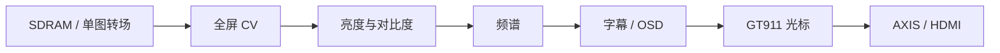

# 显示板运行时 CV 图像效果

更新：2026-10-30。正式显示顶层使用 `cv_pixel_effects_runtime`，一次综合包含全部六种效果，默认原图。Sobel/锐化曾在视频集成期暂时关闭，现已恢复并通过用户测试，见 [恢复与验收](video_statistics_full_cv_20261030.md)；资源见 [板卡状态](board_status.md)。本文不把最初的“编译时选一个效果”原型描述为当前产品。

## 控制与作用范围

| 模式值 | 效果 | PC / UART / HC-08 命令 |
| ---: | --- | --- |
| 0 | 原图 | R |
| 1 | 灰度 | G |
| 2 | 二值化 | B |
| 3 | Sobel 梯度 | E |
| 4 | 锐化 | H |
| 5 | 雪花 | W |

媒体板将请求转成显示 `0x0040 SET op=9 value=0..5`，收到实际设置 ACK 后返回 PC。HC-08 使用 `[CMD, ~CMD]`，完整字节见 [命令表](hc08_control_commands.md)。ACK 证明设置被接收，不单独证明输出像素正确；像素行为由仿真和板级观察验收。

图片 CV 作用于最终全屏合成画面，单图、双图、四宫格使用同一条处理路径；黑边同样受效果影响。每个窗口不单独配置效果。独占视频期间强制原图路径，停止后恢复用户保存的 CV 模式。媒体包、SDRAM 内的原始 RGB565、PC D 源图与音频不经过 CV。



## 像素实现与时序

像素时钟约 75 MHz，活动区域 1280×720，总行宽 1650 拍。`cv_pixel_effects.v` 同时包含固定参考模式和生产运行时封装；不能把固定 MODE=0 的组合直通延迟当作整个运行时模块的延迟。

运行时 `mode_active` 在输入 VS 上升沿锁存，`mode_output` 在对应输出帧边界切换。卷积与点效果使用相同延迟后的 DE/VS，切换不改变 HDMI 栅格相位：

- 灰度采用定点亮度；二值化按亮度阈值输出；雪花采用确定性伪随机/帧位置变化。
- Sobel、锐化共享邻域卷积引擎。三块轮换 RGB565 行 RAM 避免同一 bank 同地址读写冲突，算术分级寄存；边界按既有测试 golden 处理。
- 原图、灰度、二值化和雪花共用 RGB565 环形同步 RAM 延迟，与卷积路径的 `H_TOTAL+4` 同步环及末级寄存对齐。
- RAM 不逐地址复位，延迟有效信号屏蔽无效数据。字幕、OSD 和光标使用 CV 输出时序，因此不被卷积处理。

## 曾出现的切模式黑屏

2026-10-22 的早期运行时实现对点效果采用乒乓行缓存，bank/address 相位不能可靠匹配卷积路径，并有一拍 RGB/DE/VS 对齐错误。切入/切出锐化或雪花会偶发短暂黑屏。现在使用同步环形 RGB565 延迟，所有模式保持共同相位；测试连续切换 18 帧，对照像素、模式锁存及同步，用户上板确认该症状修复。

2026-10-23 多窗口隔离验收时，正式顶层曾临时保留 `assign cv_data=vout_data_raw` 等旁路，导致控制 ACK 存在但没有 CV 效果。当前已恢复真实运行时实例并重新生成正式 bit。`boardtest/reference_builds/multiview_diag_cv_bypass_20261023` 的历史诊断 bit 仍绕过 CV，不能用于全功能验收。

## 验证与资源口径

```sh
make -C boardtest cv-unit axis
make -C boardtest ctrlset media-control media-reply
python scripts/web_console/test_console_protocol.py
```

`cv-unit` 覆盖六种固定效果与运行时选择、帧中改变请求但输出仍按帧锁存、邻域 golden、RGB/DE/VS 等相位；AXIS 测试覆盖 1280 像素行结束和 SOF。全屏 CV→AXIS 的临时联合测试与板级诊断曾确认连续完整帧进入 AXIS，诊断结果只属于对应诊断 bit。

当前正式构建在双图/四宫格提交后依次选择六种 CV，均收到匹配 ACK；用户随后报告测试无异常。D 与 BMP 精确比较只能证明源图，不可作为 CV 输出 golden。

历史全工程 P&R 对照：

| 阶段 | LUT | FF | BRAM9K / BRAM32K | DSP | Setup / Hold WNS (ns) |
| --- | ---: | ---: | --- | ---: | --- |
| 2026-10-21 运行时选择早期版 | 14,317 | 10,211 | 37 / 12 | 10 | −5.753 / −3.056 |
| 2026-10-22 等延迟切换修复 | 14,339 | 10,227 | 37 / 13 | 10 | −5.699 / −3.188 |
| 2026-10-23 多窗口、CV 旁路 `772abc8` | 13,271 | 9,306 | 34 / 7 | 18 | 见该提交报告 |
| 2026-10-23 多窗口与完整 CV | 14,862 | 10,106 | 35 / 11 | 18 | −5.777 / −3.008 |

这是整个显示板的数值，不是 CV 模块独占，也不能把不同阶段的 LUT 变化全部归因于 CV。当前报告仍有静态时序违例。后续比较资源时固定功能集合、TD 设置和源码输入，再看同口径报告。

## 当前工作区：雪花外观调整

雪花从 8 个小十字改为两层程序化雪场：64px 格中的 13×13 六瓣带分叉雪花、128px 格中的小远景雪花，分别每帧下落 2px/1px，并有缓慢横向摆动。格位置经小型哈希决定，不分配逐片坐标 RAM、不复制 DFT/卷积，不增加图像帧缓存。按用户预览反馈，将初版密度减少约三分之一：近景格占用率为 1/2，远景为 1/4；720p 测试帧雪花像素由 7,312 减至 4,795（减少约 34%）。

`snow-unit` 使用独立雪花位图、整帧密度与移动断言；`cv-unit` 继续检查全部模式和帧同步。测试栅格循环限制 Verilator 展开数为 1，避免把测试循环展开成数十 MiB 的 C++。用户已确认实际 HDMI 样式效果良好并授权提交；CV 复位仍默认为原图。
