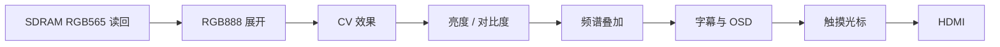

> **Current worktree update (2026-10-21):** The earlier compile-time-only notes below describe the exploration prototype. The current worktree has runtime selection on the product path through `0x0040 SET op=9`, defaults to pass-through, and applies the selected effect at a frame boundary. Web controls and the media-board UART aliases select raw, grayscale, binary, Sobel, sharpen, or snow. Runtime RTL simulation passes; hardware validation is still pending. See the final section for the runtime implementation and current synthesis result.

# 显示板 CV 像素效果探索

## 范围与当前状态

本次在显示板视频输出路径加入了可综合时选择的 HDMI 图像处理原型。处理只影响 HDMI 画面；媒体板发送的数据、SDRAM 帧缓存、PC 的 D 快照和音频路径都不经过 CV 模块。

当前工作区默认 `CV_EFFECT_MODE=0`，输出为旁路。综合后的 LUT、寄存器、BRAM 和 DSP 数量与原基线逐项相同，表示默认模式没有增加硬件成本。所有改动尚未提交，也没有把实验 bit 下载到 FPGA。

实现和验证文件：

- `board_display/user_source/hdl_source/SD/cv_pixel_effects.v`：CV 像素模块。
- `board_display/user_source/hdl_source/top_tf_hdmi_audio.v`：选择参数和视频链路连接。
- `board_display/td_project/lab_ex5_i2s_v1.0.al`：TD 源文件列表。
- `boardtest/vsrc/tb_cv_pixel_effects.sv`、`boardtest/Makefile`：Verilator 像素级测试。
- 综合报告与完整 TD 日志保存在忽略目录 `boardtest/captures/cv_probe/`。

## 视频链路和延迟

像素时钟为 75 MHz，活动画面为 1280×720，时序总行宽为 1650 拍。CV 插在 RGB565 展开之后、亮度/对比度、频谱、字幕/OSD 和鼠标光标之前。亮度/对比度和频谱在 CV 后叠加，字幕、面板和光标使用 CV 延迟后的 DE/VS，因此 UI 不会被卷积模糊。

模式 0 对 RGB、DE、VS 完全旁路。灰度、二值、雪花模式寄存一个像素周期。Sobel 和锐化使用三行水平 tap、两级算术流水，DE/VS 与像素共同延迟 `H_TOTAL+4` 拍；两种 3×3 算法的第一行和最后一行输出黑色，行内边缘按零补边处理。

卷积行缓存以 16 位 RGB565 保存像素。输入本来就是 RGB565 展开值，回打包后可无损恢复；三个轮换 bank 避免同一个 BRAM 在同一拍读写同一地址。每块 bank 由综合器推断为 32K BRAM。同步的 DE/VS 环形延迟另推断一块 9K BRAM。

## 效果定义

| `CV_EFFECT_MODE` | 效果 | 实现 |
| --- | --- | --- |
| 0 | 直通 | 原 RGB 和 DE/VS 组合旁路，保持当前稳定显示路径。 |
| 1 | 灰度 | 先算 `Y=(5R+9G+2B)/16`，将 Y 复制到 RGB。权重近似 Rec.601，使用移位和加法，不用乘法器。 |
| 2 | 二值化 | `Y >= 128` 输出白色，否则黑色；亮度/对比度仍在后级生效。 |
| 3 | Sobel | 对 3×3 亮度窗口计算 Gx/Gy，输出 `(abs(Gx)+abs(Gy))>>3` 灰度梯度图。 |
| 4 | 锐化 | 亮度高提升 `Y'=clamp(5Yc−N−S−E−W)`，把 `Y'−Yc` 加到中心像素的 RGB 通道并钳位，保留颜色。 |
| 5 | 雪花 | 8 个十字形亮点按帧向下移动 1 或 2 像素，到底部后回到顶部。位置分布固定，不需要 BRAM 或 DSP。 |

当前通过修改顶层参数选择效果；没有增加串口、网页或运行时切换命令。需要恢复原图时保持值为 0。

## 综合资源

下表是完整显示板 `syn_1`（read design → opt gate）在同一 TD 设置下测得的总资源。资源增量相对于模式 0 的 12,565 LUT、9,833 个寄存器、36 块 BRAM9K、9 块 BRAM32K 和 10 个 DSP。

| 模式 | LUT | LUT 变化 | 寄存器 | BRAM9K | BRAM32K | DSP | 综合 setup WNS |
| --- | ---: | ---: | ---: | ---: | ---: | ---: | ---: |
| 0 直通 | 12,565 | 基线 | 9,833 | 36 | 9 | 10 | −8.325 ns |
| 1 灰度 | 12,391 | −174 | 9,842 | 36 | 9 | 10 | −8.166 ns |
| 2 二值 | 12,324 | −241 | 9,835 | 36 | 9 | 10 | −8.363 ns |
| 3 Sobel | 12,875 | +310 | 9,990 | 37 | 12 | 10 | −8.371 ns |
| 4 锐化 | 12,997 | +432 | 10,026 | 37 | 12 | 10 | −8.309 ns |
| 5 雪花 | 13,026 | +461 | 9,948 | 36 | 9 | 10 | −8.471 ns |

灰度和二值化减少 LUT，是因为 RGB 三通道后级运算可以合并；其资源变化是完整系统优化后的净值。雪花 LUT 比最初的动态循环实现减少约 139 个：把八个粒子的 x 比较改为展开的常量比较，避免综合出动态索引/算术。

TD 层级报告中 CV 子模块本身的资源如下。`LUT`、`ripple`、`seq` 是 TD hierarchy area 列；系统总资源表仍以全工程 `#lut` / `#reg` 利用率为准。

| 模式 | CV 子模块 LUT | ripple 单元 | 时序寄存单元 | 推断 RAM |
| --- | ---: | ---: | ---: | ---: |
| 0 直通 | 0 | 0 | 0 | 0 |
| 1 灰度 | 24 | 16 | 10 | 0 |
| 2 二值 | 17 | 16 | 3 | 0 |
| 3 Sobel | 257 | 120 | 159 | 4 |
| 4 锐化 | 270 | 127 | 194 | 4 |
| 5 雪花 | 398 | 92 | 115 | 0 |

Sobel 和锐化共用 3 行缓存。它们额外占 3 块 BRAM32K 和 1 块 BRAM9K；显示板基线有 9/16 块 BRAM32K，启用后占 12/16，剩 4 块。DSP 数量不变。

## 布局布线结果

对最有代表性的两种卷积效果做了完整布局布线和 final timing：

| 模式 | LUT | 寄存器 | BRAM9K / BRAM32K | DSP | setup WNS | hold WNS |
| --- | ---: | ---: | ---: | ---: | ---: | ---: |
| 0 原基线 | 13,161 | 9,839 | 36 / 9 | 10 | −5.699 ns | −3.188 ns |
| 3 Sobel | 13,490 | 9,990 | 37 / 12 | 10 | −5.699 ns | −2.935 ns |
| 4 锐化 | 13,570 | 10,029 | 37 / 12 | 10 | −5.699 ns | −2.957 ns |

早期 Sobel 原型的时序路径显示 BRAM 读、亮度换算和梯度运算串在同一拍，共 17 级逻辑。改为寄存水平邻域，再用两级算术流水后，Sobel 与锐化都回到与基线相同的全局 setup WNS；hold WNS 也比基线好约 0.23–0.25 ns。最终报告副本为 `boardtest/captures/cv_probe/reports/mode3_corrected_*` 和 `mode4_corrected_*`。

点运算效果只完成综合，没有分别布局布线；它们对资源影响很小，综合 setup WNS 与模式 0 相差不超过 0.16 ns。最终资源报告副本和日志都在 `boardtest/captures/cv_probe/reports/` 与 `logs/`。

## 仿真验收

执行 `make -B cv-unit`，使用 Verilator 5.032 对所有六个模式并行跑同一组小栅格测试，结果通过：

- 模式 0 逐拍旁路；灰度和阈值结果正确。
- Sobel 与锐化对照参考 3×3 像素计算，含左右边界、上下边界。
- 雪花出现、运动输出范围正确；所有效果的 DE/VS 延迟与参数一致。

测试使用 8×4 活动像素、12 拍总行宽，覆盖控制、邻域和边界行为；完整 1280×720 存储资源映射由 TD 全工程综合确认。未下载实验 bit，也未进行 HDMI 实板观感验收。

## 后续使用建议

1. 保持 `CV_EFFECT_MODE=0` 作为正式默认值，后续若要演示效果，在测试构建中改顶层参数即可。
2. 灰度、二值和雪花适合作为低风险入门效果；Sobel 和锐化的画质更丰富，但会预留 3 块 BRAM32K 和 1 块 BRAM9K。
3. 若要加入运行时切换，先设计新的控制接口并测量资源；目前原型不改变 PC、媒体板、音频和 SDRAM 写入路径。

## Runtime selectable implementation (current worktree)

The production HDMI path now includes all six effects in one synthesis. `ctrl_core` stores op 9 as a three-bit mode and exports a Gray-coded copy to `video_clk`; `cv_pixel_effects_runtime` samples that selection only on the input VS rising edge. A selection made during a frame therefore affects the next frame. Mode 0 is a true direct RGB/DE/VS path. Modes 1, 2 and 5 share a one-cycle point-effect pipeline. Sobel and sharpen share one convolution engine and its line stores.

The existing PC command envelope remains `[CMD, CMD XOR 0xFF]`. Keys R/G/B/E/H/W select raw/grayscale/binary/Sobel/sharpen/snow. The media board forwards each selection as absolute display `0x0040 SET op=9 value=0..5`, waits for `0x0041 ACK`, and carries the current mode in reserved image-index bits in existing V1 ACK/status messages. The web console shows the active mode and highlights its button. See `docs/media_link_protocol.md` for byte assignments.

The updated `make cv-unit` drives six consecutive frames, switches through all modes, changes the raw requested mode halfway through each frame, and checks that output remains on the frame-latched choice. It compares each runtime mode against the fixed reference datapath and checks RGB/DE/VS alignment. `make ctrlset media-control media-reply` and `python -m unittest test_console_protocol.py` cover the SET range, media forwarding, ACK/status packing, and web command aliases.

Runtime-enabled TD synthesis after restoring direct mode-0 bypass: 13,665 LUT, 10,204 registers, 37 BRAM9K, 12 BRAM32K, 10 DSP; setup WNS -8.455 ns and hold WNS +0.471 ns. The corresponding final placed/routed values are recorded below after bit generation. These measurements include the complete display top, not just the CV hierarchy. At synthesis, the CV hierarchy uses 785 LUT, 269 ripple elements, 344 registers, and four line/sync RAM instances. The routed hierarchy report lists 713 LUT, 269 ripple elements, 419 registers, and four BRAM instances; physical optimization changes the logic mapping.

The generated bit is for user board validation; no FPGA image check has yet been reported for the runtime-selectable build.

Final TD P&R for the direct-pass-through runtime selector: 14,317 LUT (73.05%), 10,211 registers (52.10%), 37 BRAM9K, 12 BRAM32K, 10 DSP, and 8,302 slices (84.71%). Compared with the stable display baseline P&R (13,161 LUT, 9,839 registers, 36/9 BRAM9K/BRAM32K, 10 DSP, setup/hold WNS -5.699/-3.188 ns), this adds 1,156 LUT, 372 registers, one BRAM9K, and three BRAM32K. Final setup/hold WNS is -5.753/-3.056 ns; setup differs by 0.054 ns and hold improves by 0.132 ns. No hardware board validation is recorded yet.

Bit artifact: `board_display/td_project/lab_ex5_i2s_v1.0_Runs/phy_1/lab_ex5_i2s_v1.0.bit`, 659,888 bytes, SHA-256 `7BD43A6A5003DDF8C17EF82CC8E052DDF237329BCE5DF29765C534B3E3813A0F` (generated 2026-10-21 21:35:11 local time).

## 2026-10-22: transition blackout fix and board validation

The first runtime implementation could briefly blank the HDMI output when switching between point effects (including snow) and convolution effects (including sharpen). The point-effect path used a ping-pong line buffer whose bank/address phase did not reliably match the convolution path. The unit test also exposed a one-cycle DE/VS and RGB alignment error.

The point path now uses a synchronous circular RGB565 BRAM delay matched to the convolution latency. Both paths share the same delayed DE/VS phase, and the selected effect changes on the corresponding output-frame boundary. The testbench exercises three full effect cycles (18 frames), including repeated transitions into and out of sharpen and snow, and checks pixel values plus DE/VS alignment.

`make -B cv-unit` passes. TD synthesis confirms the point delay memory is inferred as BRAM rather than LUT logic. Final P&R reports 14,339 LUT, 10,227 registers, 37 BRAM9K, 13 BRAM32K, and 10 DSP; setup/hold WNS is -5.699/-3.188 ns. The user reports all tested effects and transitions work correctly on the board. This supersedes the earlier pending hardware-validation notes above.

Validated display bit: `board_display/td_project/lab_ex5_i2s_v1.0_Runs/phy_1/lab_ex5_i2s_v1.0.bit`, SHA-256 `18580C54A44E647BFE5879C30ADED1E431222939FFF9234B0A6D594A91464F4C`.
